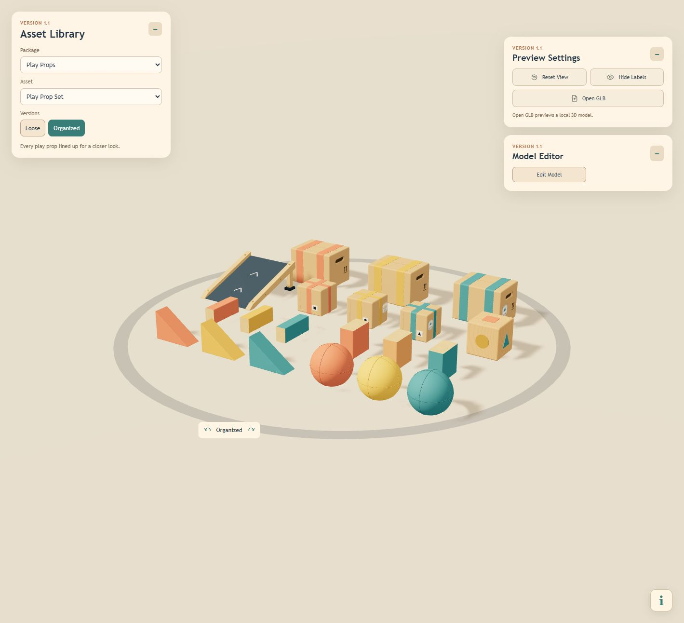
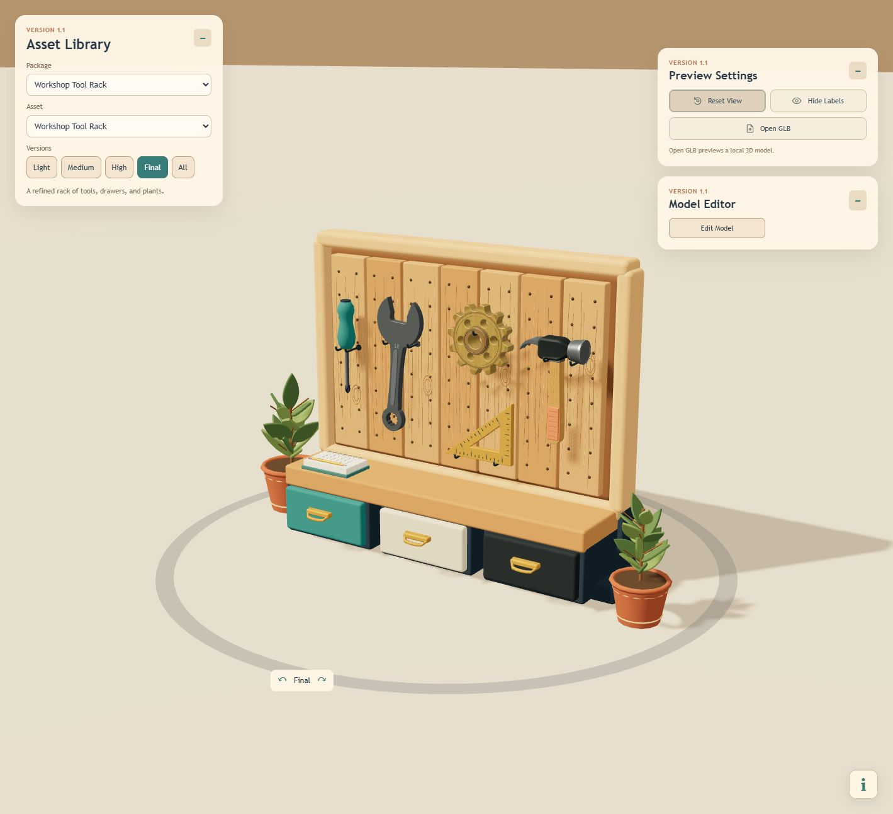
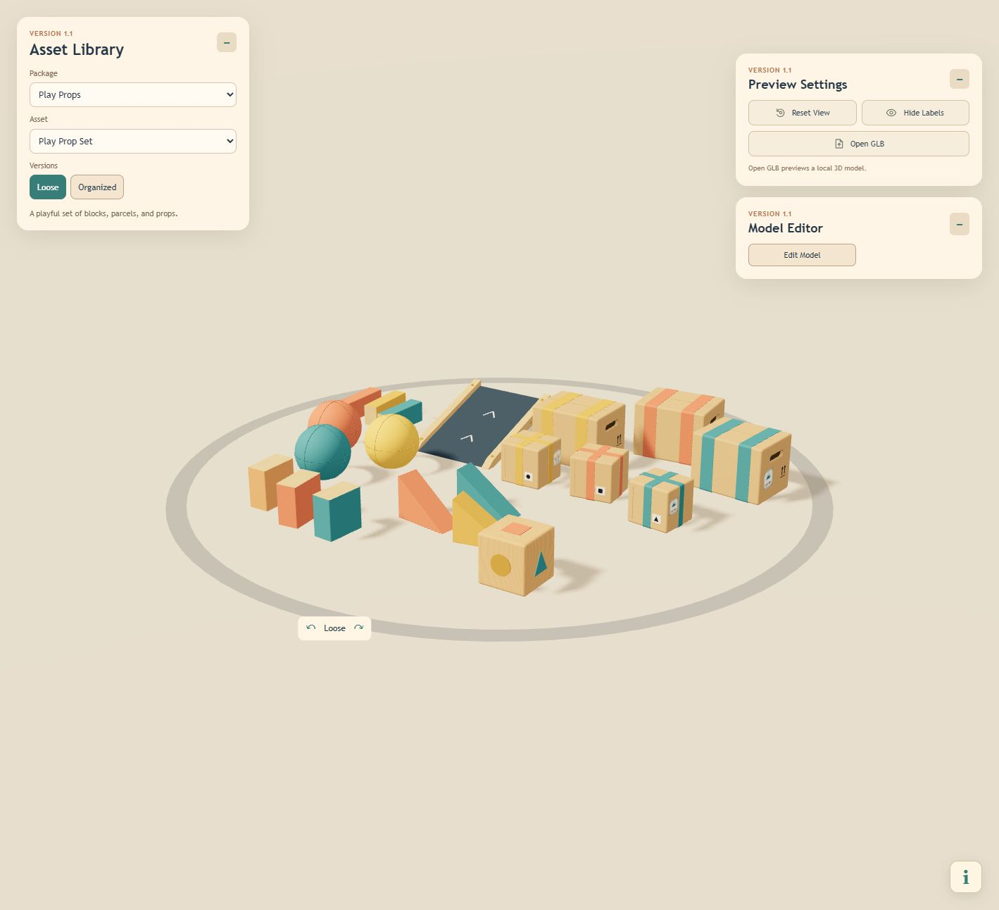

# Asset Library

An interactive 3D asset collection and model editor by **Dawson Le**.

Warm wood, soft colors, brushed metal, and playful forms. Explore complete scenes, inspect individual props, experiment with physics, and edit the parts that bring each asset to life.

[Live Demo](https://kledawson.github.io/Asset-Library/) · [Changelog](CHANGELOG.md) · [Run Locally](#run-locally) · [MIT License](LICENSE)

**Checkpoint 1.1** — Two asset collections, twenty Play Props, and a shared editor with material colors and interactive help.

[1.0 · October 11, 2026](https://github.com/kledawson/Asset-Library/releases/tag/v1.0) → [1.1 · October 14, 2026](https://github.com/kledawson/Asset-Library/releases/tag/v1.1)





*Captured directly in Asset Library: Play Props · Organized and Workshop Tool Rack · Final.*

## Collections

| Collection | Included |
| --- | --- |
| **Workshop Tool Rack** | A furnished wooden rack with eight individual assets: screwdriver, wrench, brass cog, hammer, measuring triangle, pencil, notebook, and plant. Light, Medium, High, and Final comparisons. |
| **Play Props** | Twenty props across eight asset types: wooden ramp, large and small parcels, decorated cube, timber blocks, chunky blocks, wedges, and balls. Loose and Organized set layouts. |

Play Props share a coral, yellow, and teal palette; Chunky Blocks use orange in place of yellow. Colored assets have individual version tabs and an **All** comparison view. Both set layouts reuse the same individual props.

## Explore, Edit, Save

- **Inspect from every angle.** Orbit, pan, zoom, or drag the rotation ring. Shared preview settings keep individual assets consistent.
- **Try the physics.** Drop Test raises and releases a prop; Reset Prop returns it to the floating preview. Balls bounce and roll.
- **Edit an item or a part.** Move, rotate, resize, duplicate, remove, and enter precise transforms, with Undo and Redo.
- **Adjust materials.** Use the color square, Hue and Brightness sliders, or Hex/RGB fields. Select a material on parts with multiple surfaces; retain their existing texture and finish.
- **Keep scenes in sync.** Saving an individual tool updates the Final rack. Saving a Play Prop updates its matching instance in both Loose and Organized sets.
- **Preview your own files.** Open GLB temporarily displays a local model in Imported Models.

The bottom-right **i** button opens **Controls & Help**, with expandable sections and interactive shortcut demonstrations. Panels are draggable and collapsible; Model Editor sections collapse individually.

<details>
<summary><strong>In-App Gallery</strong> — actual captures from version 1.1</summary>

<table>
<tr>
<th>Workshop Tool Rack · Final</th>
<th>Play Props · Loose</th>
</tr>
<tr>
<td></td>
<td></td>
</tr>
</table>

</details>

## Run Locally

Use **Node.js 20 or later** and npm.

```sh
npm ci
npm start
```

Open **[localhost:3002](http://localhost:3002/)**. Startup also launches the local save service on **127.0.0.1:3001** if it is not already running. If that helper needs to be restarted separately, run `npm run asset-server`.

| Navigation | Shortcut |
| --- | --- |
| Previous / next asset | ↑ / ↓ |
| Previous / next version | ← / → |
| Previous / next package | Page Up / Page Down |
| Orbit / zoom / pan | Left drag / wheel / right drag |

Navigation stops at the ends of each list. The in-app help guide covers selection, editing, rotation, and save controls.

## How Saving Works

| | Local development | Published website |
| --- | --- | --- |
| Saved models | GLB files and metadata in this project | Binary GLBs in this browser's IndexedDB |
| Linked scenes | Final rack or both Play Prop Set layouts | The same links, within this browser |
| Previous / Next Save | Available disk backups | History created in this browser |

Hosted edits persist through reloads but stay on that browser and device. They do not update GitHub; clearing site data removes them. Unsaved editor drafts are also browser-local. Imported GLBs are temporary previews.

<details>
<summary><strong>Asset source and revision workflow</strong></summary>

Keep approved exports, editor sources, save metadata, backups, and pending revisions together. Individual tool saves update Final while preserving Light, Medium, and High comparisons.

Stage a generated revision, then inspect it and apply it with **Save Model**:

```sh
node scripts/stage-asset.cjs tool-pencil:high path/to/candidate.glb
```

Historical modeling scripts include superseded experiments and may depend on older geometry. Use a separate working copy when revisiting them.

</details>

## Development

Built with React, Three.js, React Three Fiber, Drei, and Rapier; Express provides local file saving.

```sh
npm run verify:assets
npm run build
```

The verifier checks model containers, embedded resources, required exports, save metadata, and local imports. Production output goes to `build/`. GitHub Actions publishes pushes to `main` through GitHub Pages.

- [Changes since the Tool Rack release](CHANGELOG.md#11--october-14-2026)
- [Package plans and asset reuse](docs/ASSET-PACKAGES.md)
- [Release.Patch versioning](docs/VERSIONING.md)
- [Detailed development history](docs/history/2026-10-14_1.1-development-log.md)

Approved models live in `public/models/`; editing baselines are in `public/models/editor-sources/`. Timestamped concepts and references are archived in `assets/raw-assets/`, and progress screenshots in `assets/progress/`. The separate driving portfolio is outside this repository's application scope.

## License

Copyright © 2026 Dawson Le. Code and original models are released under the [MIT License](LICENSE). See [Third-Party Notices](THIRD_PARTY_NOTICES.md) for dependency and typeface information.
