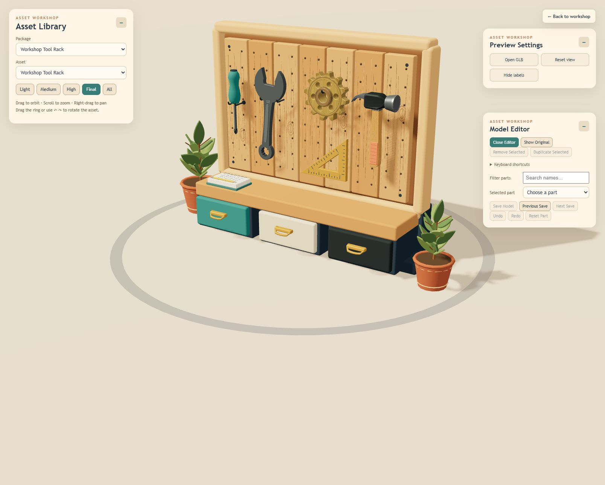

# Asset Library

### A little workshop, built one detail at a time.

A playful 3D asset workshop by **Dawson Le**. Explore a textured wooden rack, inspect its tools, experiment with physics, and edit the pieces that make each asset your own.



Warm brass, soft colors, readable silhouettes, and small personal touches define the art direction. The pencil carries **Dawson Le ©** and **#2/DL** lettering inspired by familiar school pencils.

## Features

- Light, Medium, High, Final, and All rack comparisons.
- Eight individual assets: screwdriver, wrench, cog, triangle, hammer, plant, pencil, notebook.
- Consistent camera, rotation ring, reset position, and drop height.
- Two-stage Drop / Reset physics preview.
- Whole Item or individual Element selection, teal/orange highlights, and outside-click clearing.
- Move, rotate, resize, precise adjustments, duplicate, remove, undo/redo, copy/paste.
- Save actual GLB files, synchronize individual edits into Final, and restore previous/next saves.
- Draggable, collapsible panels; model comparisons and historical screenshots.

## Run locally

Use Node.js 20 LTS or later. From this repository:

```sh
npm ci
npm start
```

Open **http://localhost:3002**. In a second terminal:

```sh
npm run asset-server
```

The save service listens on **127.0.0.1:3001**. Both processes are required for file saving and history restoration. Unsaved drafts remain browser-local.

```sh
npm run verify:assets
npm run build
```

The build goes into `build/`. This project starts the Asset Library directly.

## Controls

| Action | Control |
| --- | --- |
| Orbit / pan / zoom | Left drag / right drag / scroll |
| Select | Choose Item or Element, then click |
| Clear selection | Click outside / Esc |
| Move / rotate / resize | W / E / R |
| Copy / paste | Ctrl+C / Ctrl+V |
| Duplicate | Ctrl+B |
| Undo / redo | Ctrl+Z / Ctrl+Shift+Z |
| Enter rack / return to All | Double-click |

All view is read-only. Open Final and its editor to select rack parts. Individual assets are editable in their own views. Selection waits 200 ms to distinguish double-click navigation.

## Repository guide

| Folder | Contents |
| --- | --- |
| `src/` | Editor, preview, catalog, selection, material and saving code |
| `public/models/` | Approved exports and saved-transform metadata |
| `public/models/editor-sources/` | Geometry baselines needed to reconstruct edits |
| `scripts/` | Save service, candidate staging, modeling recipes and verification |
| `.asset-backups/` | Retained save history |
| `.asset-pending/` | Source history for staged changes |
| `.asset-candidates/` | Retained experimental candidates |
| `screenshots/` | Historical screenshots and comparison studies |
| `catalog/` | Portable asset catalog |
| `docs/` | Timestamped capture metadata and SHA-256 file inventories |

Textures are embedded in GLBs; verification checks external resources. The driving website, car, track, ramps, and website placement files are excluded. Dependencies and build output are reproducible and not committed. Screenshots document development stages rather than the exact latest appearance.

## Save workflow

Individual Save Model updates its export and linked instances in **Final**. Light, Medium, and High remain comparisons. Keep exports, editor sources, `asset-saves.json`, backups, and pending source history together.

Stage AI revisions without overwriting approved exports:

```sh
node scripts/stage-asset.cjs tool-pencil:high path/to/candidate.glb
```

Open the asset and click Save Model. Historical generation scripts are preserved for provenance; some directly write models or rely on earlier geometry. Run those on a separate working copy.

## Live website

**[Open Asset Library](https://kledawson.github.io/Asset-Library/)**

The repository is public at the author's request. GitHub Actions builds and publishes the application on pushes to main. All rack versions and individual assets are included.

On the hosted site, Save Model saves binary GLBs in this browser's IndexedDB and updates linked Final instances. Previous Save / Next Save work for saves made in this browser. These edits survive reloads, but are not written to GitHub or shared with another device. Clearing site data removes local edits. Historical disk backups remain in the repository; hosted history begins with your first browser save.

Local development continues to use the file-writing service. An optional `REACT_APP_WORKSHOP_URL` enables a link to the separate workshop website.

Chrome storage/performance: binary Blob storage, shared Final/source data, no duplicated saved metadata in localStorage, staggered preloading, and obsolete preload-revision cleanup. The source repository keeps the full model and development history; the published website includes only production code and public models.

## Development record

See [CHANGELOG.md](CHANGELOG.md) for the October 10–11 session. [Capture metadata](docs/SNAPSHOT.json) records the UTC timestamp and source hashes; [complete inventory](docs/FILES.json) records packaged files.

## License

Copyright © 2026 Dawson Le. Original code and models use the [MIT License](LICENSE). Dependencies retain their own licenses; see [third-party notices](THIRD_PARTY_NOTICES.md).

