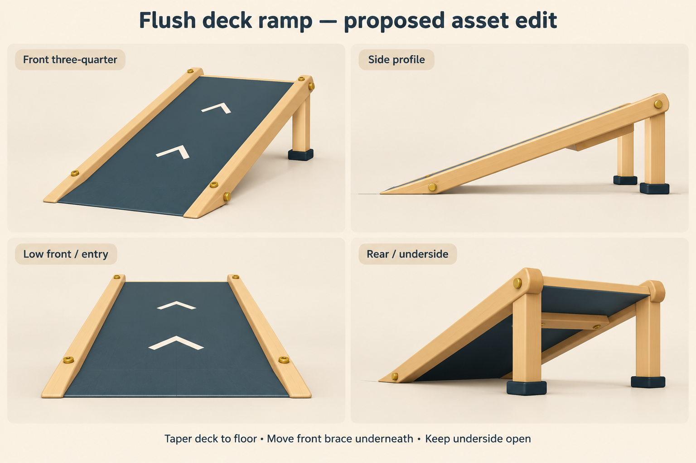

# Flush deck ramp reference

Concept for feedback; the approved ramp model has not been edited.

## Handoff for asset editing

- Taper the dark deck into a thin leading edge that meets the floor with zero vertical step in the driving path.
- Move the entrance crossbar under the slope, farther uphill. Keep the elevated underside open and preserve the side access.
- Taper the rail noses to the floor. Retain the timber, dark teal deck, two cream chevrons, brass fasteners and black rear foot pads.
- Preserve the existing deck width and rear launch height; the concept image is not a dimensioned model specification.
- Ensure collider geometry follows the visible flush entry. Test slow entry, fast launch and side/under-ramp clearance after the model edit.
- Follow the repository Save Model workflow and preserve approved exports and comparison models.

## Generation record

Generated with the built-in image generation tool. Filename records Pacific archive time and UTC offset.

Source reference: 2026-10-11_19-09-39_-0700_ramp-first-pass-v01.png.

### Prompt

Use case: stylized-concept.
Asset type: a shareable 4-view asset modeling reference sheet for Pocket Workshop Play Props.
Input image: the provided Wooden Ramp screenshot is the source reference for its design, materials, proportions and details. Ignore all screenshot UI.
Primary request: illustrate the recommended FLUSH DECK modification of this exact wooden driving ramp from multiple angles. This is a proposed asset edit, not a screenshot of an implemented model.
Keep the honey-colored timber side rails, dark slate teal driving deck with two cream forward chevron marks, small brass bolts, two wooden rear support legs with black foot pads, original open sides and empty underside. Keep width and raised rear launch height visually consistent with the reference.
Modification: extend/taper the actual driving deck smoothly down to meet the floor at its leading edge with zero vertical step across the tire path. The deck is one continuous plane from a thin ground-contact nose to the raised launch end. Taper the wooden rails near the nose so they don't obstruct entry. Remove the raised crossbar across the driving entrance and relocate its bracing under the deck further uphill. No separate add-on entry ramp, no solid wedge filling the underside, no floating front edge, no invisible collision geometry. Clearance under the elevated part of the deck remains visible.
Composition: clean landscape 2x2 contact sheet, showing the SAME consistent modified ramp in four distinct panels: 'Front three-quarter', 'Side profile', 'Low front / entry', 'Rear / underside'. The side view must clearly show the tip touching a thin horizontal floor reference line with no upstand. The low front view must show uninterrupted width of the flat entrance and no crossbar across the wheel path. Rear view must show the supports and relocated brace under the deck with open space around them.
Style: clear polished low-poly 3D asset concept render matching the original toy aesthetic, warm off-white studio floor and background, soft light, realistic geometry edges, no transparency, no hitbox overlays. Large objects framed completely in each panel, generous clean separation. Heading exactly 'Flush deck ramp — proposed asset edit'. Small bottom caption 'Taper deck to floor • Move front brace underneath • Keep underside open'. Avoid extra objects, cars, UI or decorative features. Geometry consistency and a truly flush entrance matter more than artistic detail.

