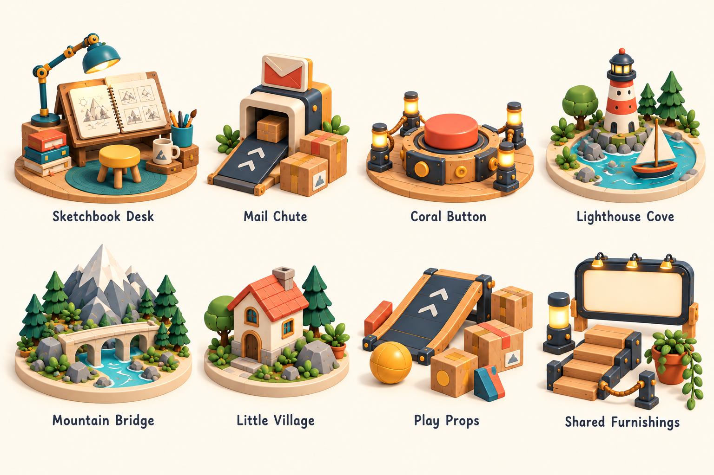

# Circular Pocket Workshop — asset packages

Planned October 11, 2026 (America/Los_Angeles). Updated for checkpoint 1.1 on October 14: Workshop Tool Rack and Play Props are available. The other packages remain plans until selected for development.

A package is one assembled scene or station, with individual editable assets inside it. Shared props keep one source asset and can appear in multiple assemblies. Work on one chosen package at a time.

## 1. Workshop Tool Rack — checkpoint complete

Rack and cabinet, screwdriver, wrench, brass cog, hammer, measuring triangle, hooks and fasteners, pencil, notebook, and potted plants. Preserve the approved Final and historical comparisons.

## 2. Sketchbook Desk — About station

Open illustrated sketchbook on a wooden stand, articulated teal desk lamp, yellow stool, cream mug, pencil cup and stacked books. Reuse the pencil and plants. A small work corner, assembled as a single station with independently editable props.

## 3. Mail Chute — Contact station

Mail chute body, envelope sign, short loading flap/ramp, envelope and parcel boxes. Reuse lanterns and planters. The chute and sign form the main object; letters and parcels remain independent props.

## 4. Coral Button — central interaction

Large coral button, dark inset housing, wooden circular base, brass trim/fasteners and rope-post perimeter. Reuse lanterns and planters. Button, base, ropes and posts can be selected separately within the assembly.

## 5. Lighthouse Cove — coastal project display

Lighthouse, sailboat, water patch, shoreline rocks, small trees and landscaped circular display base. Reuse the project display frame, stairs, lanterns and plants. Water and shoreline belong to this diorama, rather than the road.

## 6. Mountain Bridge — mountain project display

Mountain, pine trees, arched bridge, river/water patch, rocks and circular display base. Reuse display frame, stairs, lanterns and planters. Keep mountains, bridge and trees separately editable.

## 7. Little Village — village project display

Tiny house with coral tiled roof, chimney, trees, shrubs, rocks and circular display base. Reuse frame, stairs, lanterns and planters. The house may have editable walls, roof, door and windows.

## 8. Play Props — driving obstacle kit

**Checkpoint 1.1:** twenty props in Loose and Organized layouts, across eight reusable asset types. Current parcel artwork is F2 Fragile on Coral, D3 Keep Dry on Teal, and H3 Handle With Care on Yellow. All six parcels use the compact underside recycling/FSC/CE group. The notes below preserve the package's development milestones, including earlier counts and patch designs.

Standalone driving ramp, parcel boxes, wooden blocks and rolling yellow ball. One reusable kit of movable props, not permanently fused into a single obstacle. The large driving ramp is distinct from the mail chute's small loading flap.

**First pass created:** a separate Play Props package with its complete set and eight individual Default assets: Wooden Ramp, Large Parcel, Small Parcel, Decorated Cube, Coral Block, Orange Block, Teal Wedge and Yellow Ball. They use the shared editor, camera, ring, floating reset center and drop height. Individual saves update only the Play Props assembly; the ball has a spherical drop collider.

**Color collection:** Timber Block, Wedge, and Play Ball have Coral, Yellow, and Teal versions; Chunky Block has Coral, Orange, and Teal versions. The blocks have real wooden end faces on both ends and embedded end grain. The set now contains twenty props with each color separately grouped and synced through Save Model. The balls roll gently after a drop and settle.

**Set layouts:** Loose preserves the playful scene arrangement. Organized displays the same twenty reusable props upright in clear rows inside the ring. Saving an individual Play Prop updates its instance in both layouts.

**Expanded October 12:** Play Prop Set now includes twelve props, with all three colors of both parcel sizes. Original formation and rotations are retained, with modest clearance for the wedge and space for future additions. Each parcel color has its own selectable group; individual saves update only the matching size/color instance.

Local set previews and individual-save rebuilds read the assembled GLB from the Save Model service on port 3001, ensuring consecutive saves preserve the latest edits. The service remains part of the local editing workflow. Hosted builds continue to use browser storage. Large parcels have a small pair of up arrows printed on bare cardboard on the positive X face, to the right of the wrapping band.

Large parcels now have a modestly wider rectangular body, two parallel front-to-back wrapping bands, rounded carrying openings on both narrow sides, and flat front/back faces. Their cream labels and shape symbols sit in the bottom-right corner of the negative X side, opposite the lowered positive X arrow stamps. Small parcels have seamless cross wrapping, front labels, and symmetric square recesses on front and back. Previous designs remain in Save Model backups.

Both teal sizes carry a teal K1 Keep Dry umbrella stamp; both coral sizes carry a compact F2 Fragile sticker. These sit on bare negative-X side cardboard, with size-specific scales and slight rotations, away from wraps and existing labels. Yellow parcels retain their previous details.

## 9. Workshop Furnishings — shared environment kit

Warm lantern post, rope post/rope segment, illuminated project display frame, wooden stairs, planters and trailing vines. Reuse approved potted plants where appropriate. These are the shared building blocks used around the stations, rather than separate copies modeled for each scene.

## Suggested next package

**Sketchbook Desk**: a compact next scene that expands the existing art direction with a lamp, stool, mug and open sketchbook. Start with its main assets, then assemble the station. For a more mechanical object, choose **Mail Chute** instead.

## Archive convention

Save visual development to `assets/raw-assets/<package-id>/` with descriptive dated/versioned filenames. The global reference and 24-option sheet live in `assets/raw-assets/concepts/`. Preserve every useful iteration; approved models continue to use the established save/source/history workflow.

## Grouped visual menu

